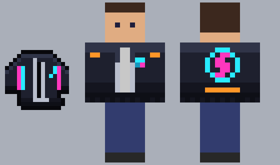

# Neon Runner — неоновая киберпанк-куртка (Minecraft 1.20.1, Forge 47.x)

## Как скачать
Нажми на файл **`neonrunner-1.20.1-1.2.0.jar`** выше → справа кнопка **Download raw file** (значок загрузки).
Положи файл в папку `mods` (CurseForge: три точки возле «Play» → **Open Folder** → `mods`).
Старые `neonrunner-…jar` из `mods` удали.

## Неоновая куртка
- Тёмный бомбер с объёмными тенями, воротником-стойкой и расстёгнутым передом (видно футболку),
  неоновыми полосами вдоль рукавов, резинками на манжетах и подоле и светящейся эмблемой-молнией на спине.
- Сидит по фигуре тонким слоем, как внешний слой скина, а не раздутой коробкой, как обычная броня.
- Надевается в слот нагрудника, защита как у железного нагрудника, не ломается.
- Пока надета — **Скорость I**.
- Крафт (без формы): **любая шерсть + земля**. Рецепт сразу есть в книге рецептов; также во вкладке «Оружие» в творческом режиме.
- Достижение: **«Ночной город»** — получить куртку.

## Исходники
Папка `source/`. Сборка: `./gradlew build` (нужен JDK 17).
